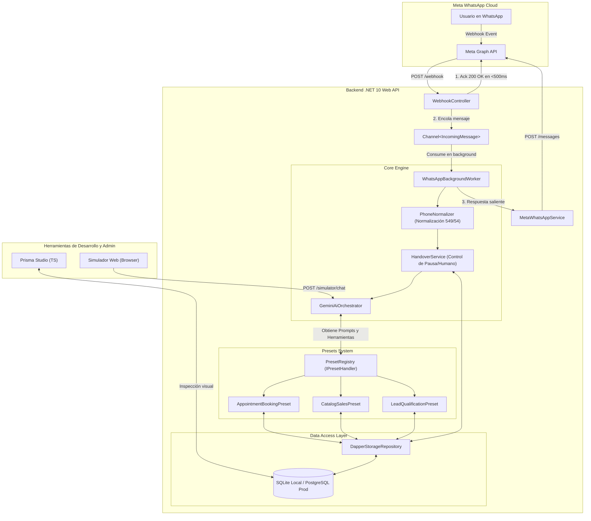
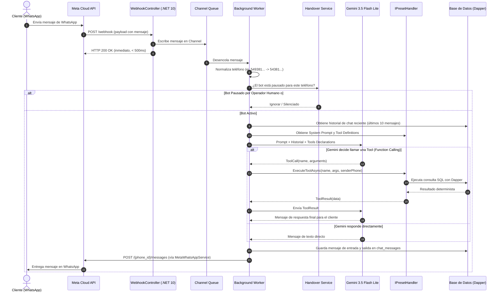

# 🏛️ Arquitectura del Sistema: WhatsApp AI Starter

Este documento define la arquitectura técnica, los componentes del sistema, el flujo de datos y las decisiones de diseño para **WhatsApp AI Starter**.

---

## 🎯 Visión y Objetivos

**WhatsApp AI Starter** es un boilerplate enterprise modular para desarrollar y desplegar chatbots comerciales con Inteligencia Artificial en WhatsApp en tiempo récord para cualquier empresa o vertical de negocio.

### Objetivos Clave
1. **Desacoplamiento Total (Plug-and-Play Presets):** Separar el 100% de la lógica comercial del motor de mensajería, permitiendo cambiar de rubro (turnos, catálogo, leads) mediante configuración o inyección de dependencias.
2. **Determinismo Estricto (Zero-Hallucination):** El modelo de lenguaje (LLM) no inventa precios ni asume disponibilidad de citas. Toda acción transaccional pasa por herramientas estructuradas (Tool Calling) validadas contra la base de datos.
3. **Respuesta Rápida a Meta (< 1s):** Handshake asíncrono inmediato con Meta WhatsApp Cloud API mediante colas en memoria (`System.Threading.Channels`).
4. **Alto Rendimiento y Simplicidad:** Backend en **.NET 10 (C#)** con consultas directas ultrarrápidas mediante **Dapper**, soportando **SQLite** para desarrollo local sin dependencias y **PostgreSQL** para producción empresarial.
5. **Visor de Datos Instantáneo:** Integración con **Prisma Studio (TypeScript)** para visualizar y administrar prospectos, citas y órdenes desde un panel web sin programar un frontend de administración desde cero.

---

## 🏗️ Diagrama General de Componentes



---

## 🔄 Ciclo de Vida de un Mensaje (Lifecycle Pipeline)



---

## 🧩 Detalle de Capas y Responsabilidades

### 1. Capa de Entrada y Controladores (`Controllers/`)
* **`WebhookController`**:
  - `GET /webhook`: Valida el token de verificación de Meta (`hub.mode`, `hub.verify_token`, `hub.challenge`).
  - `POST /webhook`: Recibe los eventos de mensajes y cambios de estado. Responde de inmediato `200 OK` y encola la carga útil.
* **`ChatSimulatorController`**:
  - Endpoints REST para probar el chatbot desde una interfaz web local sin gastar cuota de WhatsApp ni requerir túneles HTTPS.
* **`AdminController`**:
  - Endpoints para consultar leads, citas registradas y órdenes creadas por los presets.

### 2. Capa de Procesamiento Asíncrono (`Core/Workers/`)
* **`Channel<WhatsAppIncomingMessage>`**: Cola en memoria de productor-consumidor thread-safe con backpressure.
* **`WhatsAppBackgroundWorker` (`BackgroundService`)**: Procesa los mensajes en cola uno a uno por usuario para evitar condiciones de carrera en la sesión.

### 3. Normalizador Telefónico (`Core/Normalization/`)
* **Regla Meta para Argentina:**
  - Los mensajes entrantes de Argentina traen el prefijo móvil `9` (ej: `5493811234567`).
  - Sin embargo, para responder mediante Meta Graph API v21.0 en cuentas de prueba o producción, Meta exige enviar sin el `9` (`543811234567`). Si se envía con `9`, Meta devuelve el error `#131030`.
  - El normalizador transforma uniformemente los números de teléfono antes de invocar la Graph API.

### 4. Capa de Handover y Coexistencia (`Core/Services/HandoverService`)
* **Coexistencia con WhatsApp Web / Móvil:**
  - Si un operador de la empresa responde manualmente a una conversación, el bot detecta el mensaje saliente de operador y se auto-silencia por 30 minutos.
* **Comandos de Escape Manual:**
  - `#pausa` o `#humano`: Silencia el bot para esa sesión durante 2 horas.
  - `#play` o `#bot`: Reactiva el bot inmediatamente.
  - Notificaciones al administrador: Cuando un cliente solicita un humano, el sistema puede disparar una alerta al WhatsApp del asesor.

### 5. Motor de Inteligencia Artificial (`Core/Services/GeminiAiEngine`)
* **Modelo Oficial:** `gemini-3.5-flash-lite` (modelo recomendado de alta velocidad, bajo costo y soporte multimodal completo).
* **Integración Directa:**
  - Comunicación mediante HTTP Client tipado hacia la Google Generative Language API v1beta / v1.
  - Soporte de multimodalidad: transcripción de audios (`audio/ogg`, `audio/mp4`) e inspección de imágenes de recibos o productos.
  - Declaración y ejecución estructurada de **Function Calling**.

### 6. Sistema Modular de Presets (`Presets/`)
* **Interfaz `IPresetHandler`**:
  ```csharp
  public interface IPresetHandler
  {
      string Name { get; }
      string DisplayName { get; }
      string GetSystemPrompt(BusinessConfig config);
      IEnumerable<ToolDefinition> GetTools();
      Task<ToolExecutionResult> ExecuteToolAsync(string toolName, JsonElement args, string senderPhone);
  }
  ```
* **Presets Iniciales:**
  1. `AppointmentBookingPreset`: Gestión de turnos y citas médicas, estéticas o profesionales. Herramientas: `check_availability`, `book_appointment`, `cancel_appointment`.
  2. `CatalogSalesPreset`: Ventas y catálogo de comercios, ferreterías, corralones. Herramientas: `search_catalog`, `get_product_price`, `create_order`, `verify_receipt`.
  3. `LeadQualificationPreset`: Calificación B2B e inmobiliaria. Herramientas: `qualify_lead`, `record_lead_budget`, `request_agent_contact`.

### 7. Capa de Persistencia con Dapper (`Data/`)
* **`DapperStorageRepository`**:
  - Implementación con consultas SQL nativas y parametrizadas para máxima velocidad y mínima sobrecarga de memoria.
  - Compatibilidad dual mediante factoría de conexión:
    - **SQLite** para desarrollo local rápido (archivo `.db` autocreado, sin Docker ni instalación de servidores).
    - **PostgreSQL** para despliegues en producción (Supabase, Neon, AWS RDS, Railway).
  - Inicialización automática del esquema con `DbInitializer`.

### 8. Capa de Inspección de Datos (TypeScript / Prisma)
* Aunque el backend principal es C# / .NET 10, se mantiene un módulo de herramientas TypeScript con `schema.prisma` apuntando a la misma base de datos.
* Permite al desarrollador o al cliente ejecutar:
  ```powershell
  npx prisma studio
  ```
  y acceder inmediatamente a un panel web gráfico para inspeccionar leads, turnos y chats sin tener que programar un backoffice administrativo.

### 9. Módulo Opcional de RAG Semántico (`PostgreSQL` + `pgvector`)
* **Propósito:**
  Diseñado para verticales con catálogos masivos (más de 5.000 SKUs) o conocimiento no estructurado complejo (PDFs de garantías, manuales de procedimientos o normativas).
* **Arquitectura Híbrida Unificada (Sin Base Externa):**
  - En lugar de contratar servicios de terceros (como Pinecone o Weaviate), se habilita la extensión oficial **`pgvector`** sobre la misma base de datos PostgreSQL.
  - Los vectores de embeddings son generados mediante el modelo **Google Gemini `text-embedding-004`** (768 dimensiones).
  - **Dapper** ejecuta la búsqueda de vecinos más cercanos utilizando la distancia de coseno (`<=>`) y aceleración de índice **HNSW**.
* **Diferenciación Estricta:**
  - **Transaccional (Dapper Relacional):** Turnos exactos, precios vigentes, órdenes y sesiones.
  - **Semántico (Dapper + `pgvector`):** Recuperación de contexto difuso sobre qué producto o política aplica para una necesidad del cliente.

---

## 🔒 Seguridad y Buenas Prácticas

1. **Validación de Webhooks (Obligatoria):** Verificación estricta del token de handshake (`GET /webhook`) y validación obligatoria de la firma HMAC-SHA256 en el encabezado `X-Hub-Signature-256` con el App Secret de Meta en `POST /webhook` en producción.
2. **Autenticación y Control de Acceso:** Proteger todos los endpoints administrativos (`/api/admin/*`) y de simulación (`/api/chat/*`) mediante autenticación/API key; restringir políticas CORS al origen autorizado y usar `textContent` (nunca `innerHTML`) en el simulador web para prevenir XSS.
3. **Consultas Parametrizadas:** Cero concatenación de cadenas en SQL con Dapper para prevenir inyección SQL.
4. **Manejo de Errores y Degradación Elegante:** Si Gemini no responde o supera el timeout (10s), el bot responde con un mensaje de cortesía y notifica al operador.
5. **Respeto a la Ventana de 24 Horas:** Meta restringe las respuestas libres a la ventana de 24 horas posterior al último mensaje del usuario. Fuera de esta ventana, se debe recurrir a plantillas aprobadas (Templates).
