# 🗄️ Modelo de Datos: WhatsApp AI Starter

Este documento especifica el esquema de datos relacional compatible tanto con **PostgreSQL** como con **SQLite**, utilizado por el repositorio de acceso a datos **Dapper** en .NET 10 y mapeado opcionalmente en **Prisma Studio**.

---

## 📊 Diagrama Entidad-Relación (ERD)

```mermaid
erDiagram
    chat_sessions ||--o{ chat_messages : "contiene"
    chat_sessions ||--o{ leads : "origina"
    chat_sessions ||--o{ bookings : "agenda"
    chat_sessions ||--o{ orders : "realiza"
    orders ||--|{ order_items : "incluye"
    catalog_products ||--o{ order_items : "referencia"
    knowledge_chunks }o--|| catalog_products : "embedding semántico (opcional)"

    knowledge_chunks {
        string id PK "UUID del fragmento"
        string source_type "manual | pdf | catalog | faq"
        string source_id "ID de referencia externa"
        text content "Texto del fragmento o descripción"
        string metadata_json "Metadatos JSON para filtros"
        vector_768 embedding "Vector de embedding (Gemini text-embedding-004)"
    }

    chat_sessions {
        string phone PK "Teléfono normalizado (ej: 54381...)"
        string customer_name "Nombre del cliente detectado"
        timestamp last_interaction "Última fecha y hora de actividad"
        timestamp bot_paused_until "Fecha hasta la cual el bot está en silencio"
        string metadata_json "Metadatos adicionales en formato JSON"
    }

    chat_messages {
        string id PK "UUID del mensaje"
        string session_phone FK "Referencia al teléfono del cliente"
        string role "user | assistant | system | tool"
        text content "Cuerpo del mensaje o contenido estructurado"
        string whatsapp_message_id "ID del mensaje en Meta WhatsApp"
        timestamp created_at "Marca de tiempo de envío o recepción"
    }

    leads {
        string id PK "UUID del prospecto"
        string session_phone FK "Teléfono del contacto"
        string name "Nombre o razón social"
        string email "Correo electrónico"
        string interest "Rubro, propiedad o producto de interés"
        decimal budget "Presupuesto estimado"
        string status "new | qualified | contacted | closed"
        text notes "Observaciones y resumen generado por IA"
        timestamp created_at "Fecha de registro"
    }

    bookings {
        string id PK "UUID de la cita"
        string session_phone FK "Teléfono del cliente"
        string customer_name "Nombre del paciente o cliente"
        string service_name "Nombre del servicio o consulta"
        timestamp booking_date "Fecha y hora pactada para el turno"
        string status "confirmed | pending | cancelled"
        text notes "Detalles adicionales"
        timestamp created_at "Fecha de agendamiento"
    }

    catalog_products {
        string id PK "UUID del producto"
        string sku UK "Código de producto / SKU único"
        string name "Nombre del producto o artículo"
        text description "Descripción detallada"
        decimal price "Precio unitario"
        string category "Categoría del catálogo"
        int stock "Unidades disponibles"
        boolean is_active "Estado activo / inactivo"
    }

    orders {
        string id PK "UUID de la orden de compra"
        string session_phone FK "Teléfono del comprador"
        decimal total "Importe total del pedido"
        string status "pending_payment | paid | delivered | cancelled"
        string receipt_url "Enlace o referencia al comprobante de pago"
        text delivery_address "Dirección o instrucciones de envío"
        timestamp created_at "Fecha de creación del pedido"
    }

    order_items {
        string id PK "UUID del ítem"
        string order_id FK "Referencia a la orden"
        string product_id FK "Referencia al producto"
        int quantity "Cantidad comprada"
        decimal unit_price "Precio al momento de la venta"
    }
```



---

## 📋 Especificación de Tablas DDL (SQL)

### 1. `chat_sessions`
Controla el estado global de la conversación con el cliente, el bloqueo por operador humano y la normalización del teléfono.

```sql
CREATE TABLE IF NOT EXISTS chat_sessions (
    phone VARCHAR(32) PRIMARY KEY,
    customer_name VARCHAR(120),
    last_interaction TIMESTAMP NOT NULL DEFAULT CURRENT_TIMESTAMP,
    bot_paused_until TIMESTAMP,
    metadata_json TEXT
);

CREATE INDEX IF NOT EXISTS idx_chat_sessions_last_interaction ON chat_sessions(last_interaction);
```

### 2. `chat_messages`
Historial de mensajes intercambiados. Utilizado por el motor de IA para proveer memoria conversacional (sliding window) y por el operador humano para auditoría.

```sql
CREATE TABLE IF NOT EXISTS chat_messages (
    id VARCHAR(64) PRIMARY KEY,
    session_phone VARCHAR(32) NOT NULL,
    role VARCHAR(20) NOT NULL, -- 'user', 'assistant', 'system', 'tool'
    content TEXT NOT NULL,
    whatsapp_message_id VARCHAR(128),
    created_at TIMESTAMP NOT NULL DEFAULT CURRENT_TIMESTAMP,
    CONSTRAINT fk_chat_messages_session FOREIGN KEY (session_phone) REFERENCES chat_sessions(phone) ON DELETE CASCADE
);

CREATE INDEX IF NOT EXISTS idx_chat_messages_session ON chat_messages(session_phone, created_at DESC);
```

### 3. `leads` (Preset: `lead-qualification`)
Almacena leads comerciales capturados por el agente de calificación para inmobiliarias, seguros o servicios B2B.

```sql
CREATE TABLE IF NOT EXISTS leads (
    id VARCHAR(64) PRIMARY KEY,
    session_phone VARCHAR(32) NOT NULL,
    name VARCHAR(120),
    email VARCHAR(120),
    interest VARCHAR(255),
    budget NUMERIC(12, 2) DEFAULT 0,
    status VARCHAR(32) NOT NULL DEFAULT 'new', -- 'new', 'qualified', 'contacted', 'closed'
    notes TEXT,
    created_at TIMESTAMP NOT NULL DEFAULT CURRENT_TIMESTAMP,
    CONSTRAINT fk_leads_session FOREIGN KEY (session_phone) REFERENCES chat_sessions(phone)
);

CREATE INDEX IF NOT EXISTS idx_leads_status ON leads(status);
```

### 4. `bookings` (Preset: `appointment-booking`)
Controla la agenda de turnos y citas para médicos, psicólogos, estéticas o talleres mecánicos.

```sql
CREATE TABLE IF NOT EXISTS bookings (
    id VARCHAR(64) PRIMARY KEY,
    session_phone VARCHAR(32) NOT NULL,
    customer_name VARCHAR(120) NOT NULL,
    service_name VARCHAR(120) NOT NULL,
    booking_date TIMESTAMP NOT NULL,
    status VARCHAR(32) NOT NULL DEFAULT 'confirmed', -- 'confirmed', 'pending', 'cancelled'
    notes TEXT,
    created_at TIMESTAMP NOT NULL DEFAULT CURRENT_TIMESTAMP,
    CONSTRAINT fk_bookings_session FOREIGN KEY (session_phone) REFERENCES chat_sessions(phone)
);

CREATE INDEX IF NOT EXISTS idx_bookings_date ON bookings(booking_date);
CREATE INDEX IF NOT EXISTS idx_bookings_phone ON bookings(session_phone);
```

### 5. `catalog_products` (Preset: `catalog-sales`)
Listado de productos o servicios con precios fijos y control de stock para prevenir alucinaciones de cotización.

```sql
CREATE TABLE IF NOT EXISTS catalog_products (
    id VARCHAR(64) PRIMARY KEY,
    sku VARCHAR(64) UNIQUE NOT NULL,
    name VARCHAR(150) NOT NULL,
    description TEXT,
    price NUMERIC(12, 2) NOT NULL,
    category VARCHAR(80),
    stock INT NOT NULL DEFAULT 0,
    is_active BOOLEAN NOT NULL DEFAULT TRUE
);

CREATE INDEX IF NOT EXISTS idx_catalog_sku ON catalog_products(sku);
CREATE INDEX IF NOT EXISTS idx_catalog_category ON catalog_products(category);
```

### 6. `orders` y `order_items` (Preset: `catalog-sales`)
Órdenes de compra generadas automáticamente tras la confirmación del cliente y verificación de comprobantes de pago.

```sql
CREATE TABLE IF NOT EXISTS orders (
    id VARCHAR(64) PRIMARY KEY,
    session_phone VARCHAR(32) NOT NULL,
    total NUMERIC(12, 2) NOT NULL,
    status VARCHAR(32) NOT NULL DEFAULT 'pending_payment', -- 'pending_payment', 'paid', 'delivered', 'cancelled'
    receipt_url TEXT,
    delivery_address TEXT,
    created_at TIMESTAMP NOT NULL DEFAULT CURRENT_TIMESTAMP,
    CONSTRAINT fk_orders_session FOREIGN KEY (session_phone) REFERENCES chat_sessions(phone)
);

CREATE TABLE IF NOT EXISTS order_items (
    id VARCHAR(64) PRIMARY KEY,
    order_id VARCHAR(64) NOT NULL,
    product_id VARCHAR(64) NOT NULL,
    quantity INT NOT NULL,
    unit_price NUMERIC(12, 2) NOT NULL,
    CONSTRAINT fk_order_items_order FOREIGN KEY (order_id) REFERENCES orders(id) ON DELETE CASCADE,
    CONSTRAINT fk_order_items_product FOREIGN KEY (product_id) REFERENCES catalog_products(id)
);
```

### 7. `knowledge_chunks` (Módulo Opcional: RAG y Búsqueda Semántica con `pgvector`)
Diseñado para negocios con catálogos masivos (miles de artículos) o bases de conocimiento extensas (manuales, PDFs, políticas complejas). En **PostgreSQL**, utiliza la extensión oficial `pgvector` con indexación HNSW para búsquedas en sub-milisegundos.

```sql
-- Activar extensión pgvector en PostgreSQL
CREATE EXTENSION IF NOT EXISTS vector;

CREATE TABLE IF NOT EXISTS knowledge_chunks (
    id VARCHAR(64) PRIMARY KEY,
    source_type VARCHAR(32) NOT NULL, -- 'catalog', 'manual', 'policy', 'faq'
    source_id VARCHAR(128),            -- ID de referencia externa (ej: SKU, archivo)
    content TEXT NOT NULL,             -- Texto plano indexado para el prompt
    metadata_json TEXT,                -- Filtros adicionales en formato JSON
    embedding vector(768) NOT NULL,    -- 768 dimensiones (Google Gemini text-embedding-004)
    created_at TIMESTAMP NOT NULL DEFAULT CURRENT_TIMESTAMP
);

-- Índice HNSW de alta velocidad para distancia Coseno (<=>)
CREATE INDEX IF NOT EXISTS idx_knowledge_chunks_embedding 
ON knowledge_chunks USING hnsw (embedding vector_cosine_ops);

CREATE INDEX IF NOT EXISTS idx_knowledge_chunks_source 
ON knowledge_chunks (source_type, source_id);
```

> [!NOTE]
> En entornos de desarrollo local que utilicen **SQLite**, este módulo vectorial se omite o se emula mediante búsqueda de texto completo con SQLite FTS5 (`fts5`), manteniendo SQLite libre de dependencias compiladas nativas.

---

## ⚡ Consultas Clave en Dapper

### 1. Consulta de Sesión y Pausa (Human Takeover)
```csharp
const string sql = @"
    SELECT phone, customer_name, last_interaction, bot_paused_until, metadata_json
    FROM chat_sessions
    WHERE phone = @Phone;
";
var session = await connection.QuerySingleOrDefaultAsync<ChatSessionEntity>(sql, new { Phone = phone });
```

### 2. Guardar Mensaje con Transacción Rápida
```csharp
const string sql = @"
    INSERT INTO chat_messages (id, session_phone, role, content, whatsapp_message_id, created_at)
    VALUES (@Id, @SessionPhone, @Role, @Content, @WhatsAppMessageId, @CreatedAt);

    UPDATE chat_sessions
    SET last_interaction = @CreatedAt
    WHERE phone = @SessionPhone;
";
await connection.ExecuteAsync(sql, messageEntity);
```

### 3. Verificación de Citas Disponibles (Sin Alucinaciones)
```csharp
const string sql = @"
    SELECT COUNT(1)
    FROM bookings
    WHERE booking_date = @BookingDate
      AND status != 'cancelled';
";
var count = await connection.ExecuteScalarAsync<int>(sql, new { BookingDate = date });
bool isAvailable = count == 0;
```

### 4. Búsqueda Semántica de Similitud Coseno con Dapper y `pgvector`
Cuando el cliente realiza una consulta abierta o difusa sobre el catálogo o políticas, Dapper ejecuta la consulta de vectores directamente:

```csharp
const string sql = @"
    SELECT id, source_type, source_id, content, metadata_json,
           1 - (embedding <=> @QueryVector::vector) AS similarity_score
    FROM knowledge_chunks
    WHERE source_type = @SourceType
    ORDER BY embedding <=> @QueryVector::vector
    LIMIT @TopK;
";

var results = await connection.QueryAsync<KnowledgeChunkResult>(sql, new 
{
    QueryVector = vectorString, // Formato "[0.012,-0.034,...]"
    SourceType = "catalog",
    TopK = 3
});
```
